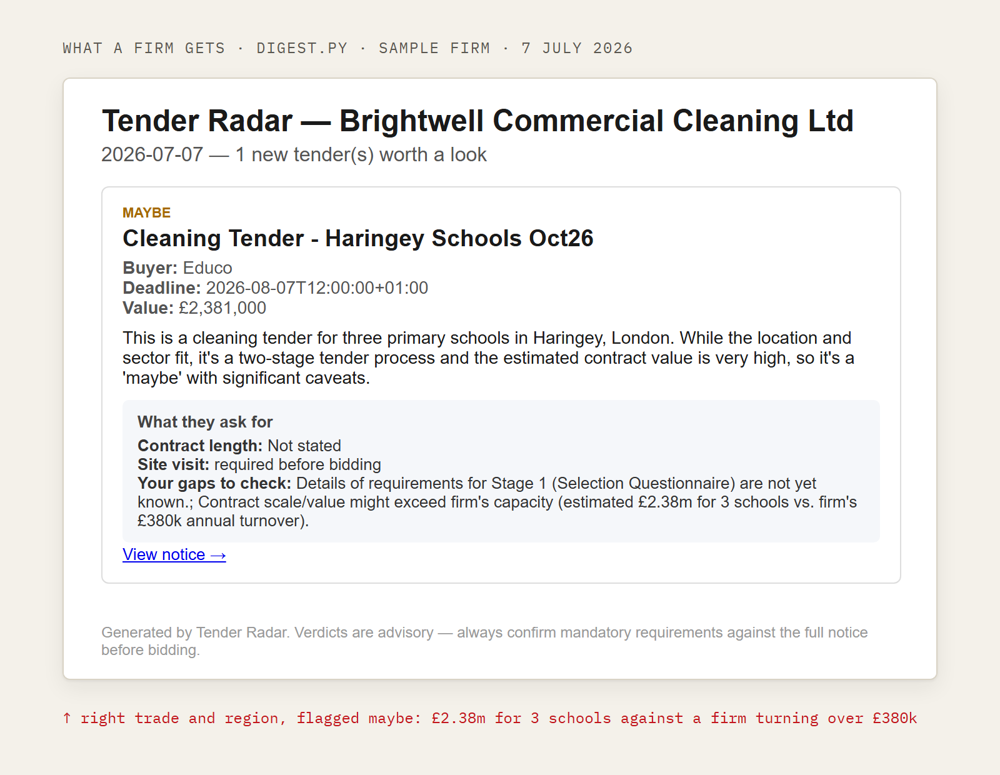

# Tender Radar

Tender Radar reads new UK public-sector contract notices every morning and tells small cleaning, security and facilities firms which ones are worth bidding on, and why.


Python 3.11, Gemini, Playwright, GitHub Actions. Live since 4 July 2026. This is the sanitised engine of a live service I built and run alone: client data, firm profiles and outreach live in a private repo.

## What it does

- Pulls new notices from Find a Tender, Contracts Finder, Public Contracts Scotland, Sell2Wales and the ProContract portal. Some school and council tenders appear only on ProContract.
- Checks every notice against every firm's profile (trade, region, turnover, certificates) and marks it bid, maybe or skip, with the reason written down.
- Keeps any tender with a past or unknown deadline out of the digest with a plain code rule, whatever the model said.
- Writes one digest per firm. A quiet week says "nothing live right now", with no filler.
- Lists competitors' wins from the last 90 days and contracts that end within 12 months (`fetch_awards.py`).

A real digest from `digest.py` for the made-up sample firm in `profiles/cleaning.yaml`:



## How it works

1. **Fetch.** `fetch.py` calls the official open-data APIs at a polite pace and waits when a site says slow down (HTTP 429). `fetch_procontract.py` reads ProContract's list pages with a headless browser.
2. **Classify.** `runner.py` sends each notice and a firm profile from `profiles/*.yaml` to Gemini. The model must quote the tender before it gives a verdict, and may not say bid when the deadline is unclear.
3. **Clean.** `build_leads.py` merges the same tender found on two sites, tags the trade from the title ("guard" must not match inside "safeguarding"), and splits leads by whether the deadline is confirmed.
4. **Deliver.** `digest.py` and `digest_client.py` write each firm's digest. Nothing is emailed automatically: a person reads it first.
5. **Schedule.** GitHub Actions starts the run every morning in the private repo. In this copy the schedule is off.

## Results

From the live run saved on 15 Oct 2026 ([the snapshot behind manveen.me](https://github.com/Manveen07/portfolio/blob/master/data/pipeline-snapshot.json)):

- 104 mornings it started on its own since 4 July 2026.
- 3,671 checks (one notice against one trade's profile) across 7 trades.
- 64 worth a look, 8 worth bidding on.

## Run it

```bash
uv sync
uv run python fetch.py --days 7                       # central feeds, no key
uv run playwright install chromium && uv run python fetch_procontract.py
mkdir -p out && uv run python build_leads.py          # leads CSVs in out/
uv run python digest_client.py profiles/cleaning.yaml
uv run python runner.py --in data/tenders-fixture.jsonl && uv run python eval.py
uv run --with pytest pytest test_radar.py             # runs on fixtures, no key
```

Only `runner.py` needs a key: `GEMINI_API_KEY` in `.env`. The two profiles here, Brightwell Commercial Cleaning and Ironside Security, are made-up sample firms.

## Limits

- The golden set has only 6 hand-labelled tenders (`data/golden-tenders.jsonl`, scored by `eval.py`). It catches a broken prompt; it can't show accuracy across thousands of notices.
- It has failed quietly. From 21 July to 11 August 2026, three new profiles lacked required fields, every morning run crashed, and nothing alerted me.
- The ProContract scraper reads list pages only, and stops with an error when the page layout changes.
- Verdicts are advice. A firm still has to read the full notice before bidding.

Built by [Manveen Singh](https://manveen.me)
